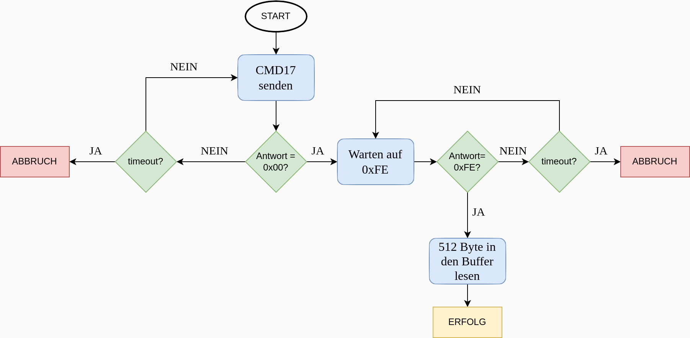
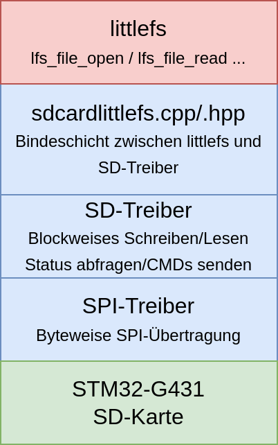
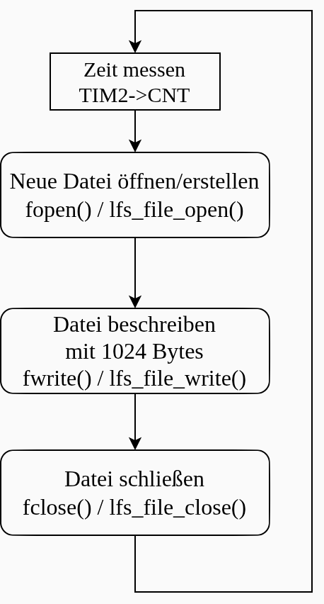
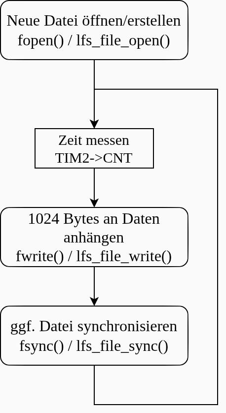
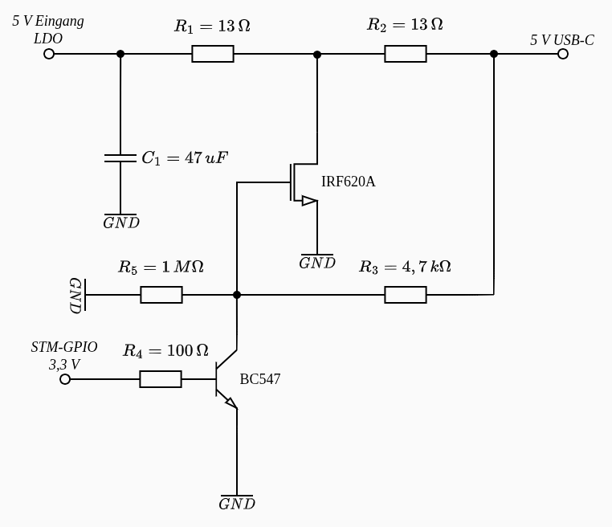

# Themen des Vortrags

1. Überblick und Motivation
2. Hardwaredesign
3. Software
    1. SPI-SD-Treiber
    2. FatFs und littlefs
6. Dateisystemtests
    1. Analyse der Schreibfehlerraten mittels bekannter Zeichenfolge
    2. Analyse der Schreibfehlerraten mittels bekannter Zeichenfolge und manipulierter Schreibfunktion
    3. Analyse von pseudo-randomisierter Zeichenfolge bei Anhang an Datei
    4. Verhalten der Dateisysteme bei Stromunterbrechungen
7. Fazit
\normalsize

---

# Überblick

* Design einer Platine, die einen STM32-G431 über eine SPI-Schnittstelle mit einem SD-Kartenslot verbindet
* Softwareseitige Implementation eines SPI-SD-Kartentreibers für blockweise Lese- und Schreibfunktionen
* Nutzung dieser Funktionen für eine Anbindung von zwei Dateisystemen: FatFs (FAT32) und littlefs
* Vergleich dieser beiden Dateisysteme über eigens erstellte Tests 

---

# Motivation technisch

* Wie größere Mengen an bspw. Sensordaten speichern oder Daten ausgeben?
* Einplatinencomputer RPI
    * Hoher Stromverbrauch (>200 mA bei 5 V vs 20 mA bei 5 V)
    * Betriebssystemoverhead / Echtzeitfähigkeit?
* Warum SD-Karten?
    * NOR-Flash 16 MB (lcsc) -> 1,9 $, 10,63 Eurocent pro MB
    * SD-Karte 32 GB (reichelt) -> 7 €, 0,0219 Eurocent pro MB

# Motivation persönlich

* Wenig Interesse am Praktikumsthema Drehgeber 
    * 3 Monate Erfahrung mit Embedded C++
* Interesse an PCB-Design
* Dateisysteme und Speicherung von Daten wenig Thema im Studium

---
# Hardware: Schaltplan

\centering
{ width=100% }


# Hardware: Platine unbestückt

\centering
{ width=100% }

# Hardware: Platine bestückt

\centering
{ width=100% }


# Hardware: Problem 2. SD-Kartenslot MISO

\centering
{ width=100% }

# Software: VSCodium + CMake + Cortex-Debug

\vspace{2cm}
\centering
\Huge \textbf{Demo}

# Software: SPI-SD-Treiber

* SPI konfiguriert auf byteweisen Transfer mit variabler SCLK
* SD-Treiber implementiert
    * Blockweises Lesen Schreiben (CMD17, CMD24)
    * Schreiben und Lesen von multiplen Blöcken (CMD18, CMD25)
    * Abfrage der CSD (Card-Specific Data, CMD9) -> hauptsächlich SD-Kartengröße


# Software: SPI-SD-Treiber blockweises Lesen (CMD17)

\centering
{ width=100% }


# Dateisystem: FatFs und littlefs Implementierungsstack

::: columns
::: column
{ width=95% }
:::

::: column
{ width=95% }
:::
:::

# Dateisysteme: FatFs und littlefs

* FatFs:
    * C-Bibliothek von Chan für alle FAT-Dateisysteme auf Mikrocontrollern
    * Out-of-Box Kompatibilität mit allen Betriebssystemen
    * Kein Journaling: Stromausfälle oder anderweitige Schreibfehler können das Dateisystem beschädigen
* littlefs:
    * Ebensfalls in C geschriebenes Dateisystem, das speziell für Flash-Speicher entwickelt und optimiert wurde
    * Dynamisches Wear-Leveling verteilt Schreibzugriffe
    * COW und two-block log für Dateisystemintegrität
    * Von PC-Betriebssystemen nicht nativ unterstützt (FUSE-Wrapper vorhanden)


# [Versuch1] Dateisystemtests: Analyse der Schreibfehlerraten mittels bekannter Zeichenfolge
\vspace{0.3cm}
\centering
{ width=35% }


# [Versuch1] Dateisystemtests: Analyse der Schreibfehlerraten mittels bekannter Zeichenfolge

\centerline{\includegraphics[width=1.35\textwidth]{Bilder/4_dateierstellzeit_all_grey.png}}

# [Versuch2] Dateisystemtests: Analyse der Schreibfehlerraten mittels bekannter Zeichenfolge und manipulierter Schreibfunktion

\small
```cpp
    // send 512 byte blockdata
    for (uint16_t i = 0; i < 512; i++) {
        //Injecting errors every 5000 byte
        if(err_cnt == 5000) 
        { 
            //some random data
             SpiDriver<Config::SpiBase>::Transfer(0xAA);
             err_cnt = 0;
             continue;
         } 
        err_cnt++;
        SpiDriver<Config::SpiBase>::Transfer(buffer[i]);
    }
```

# [Versuch2] Dateisystemtests: Analyse der Schreibfehlerraten mittels bekannter Zeichenfolge und manipulierter Schreibfunktion

\centerline{\includegraphics[width=1.1\textwidth]{Bilder/defect_filesystem.png}}

# [Versuch3] Dateisystemtests: Analyse von pseudo-randomisierter Zeichenfolge bei Anhang an Datei
\vspace{0.3cm}
\centering
{ width=35% }

# [Versuch4] Dateisystemtests: Verhalten der Dateisysteme bei Stromunterbrechungen

\vspace{0.3cm}
\centering
{ width=80% }


# Fazit

* Hardware grundsätzlich funktional -> Hauptproblem Spannungsversorgung SD-Karte
* Durch eigenen SD-Kartentreiber hohes Maß an Kontrolle möglich: Schlanke Funktionalität -> minimaler RAM/Flashverbrauch.
* FatFs überzeugt auf der SD-Karte durch einfache Handhabbarkeit, Anbindung und minimalen Overhead
* Littlefs bringt integrierten Fehlerschutz mit, führt aber zu Laufzeitkosten, die eine Echtzeitfähigkeit des Systems einschränken
    * Sinnvoller auf echter Flashhardware statt SD-Karte

# Q&A

\vspace{2cm}
\centering
\Huge \textbf{Danke für die Aufmerksamkeit}

\vspace{0.5cm}
\Large
Fragen & Antworten