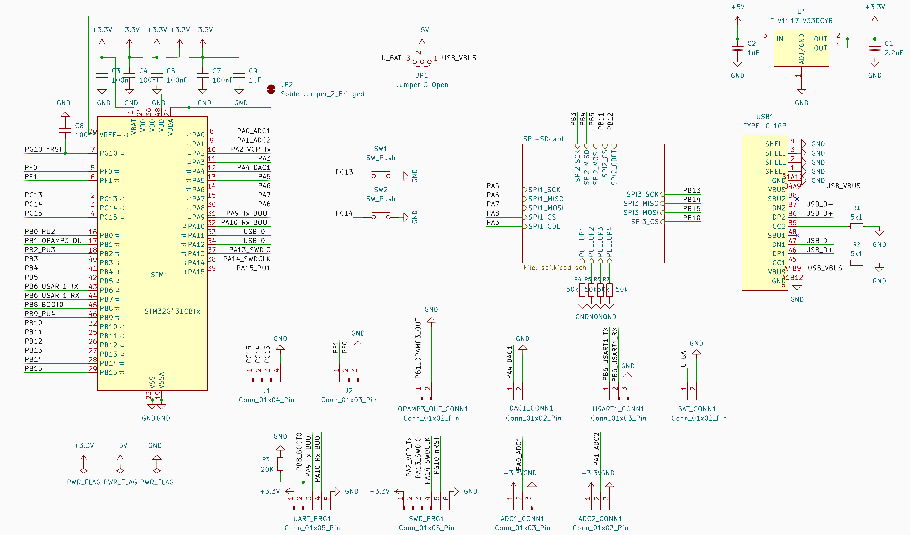
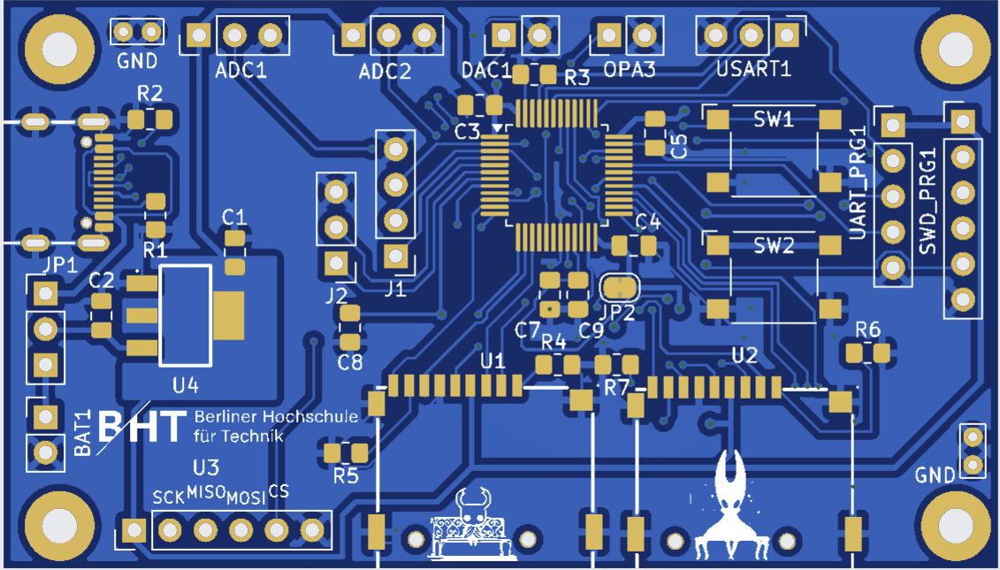
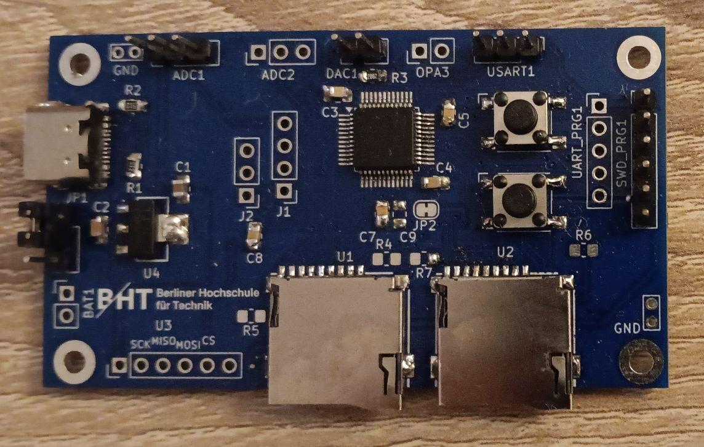

# Themen des Vortrags
\footnotesize
1. Überblick und Motivation
2. Hardwaredesign
3. Software
    1. SPI-SD-Treiber
    2. FatFs und littlefs
6. Dateisystemtests
    1. Analyse der Schreibfehlerraten mittels bekannter Zeichenfolge
    2. Analyse der Schreibfehlerraten mittels bekannter Zeichenfolge und manipulierter Schreibfunktion
    3. Analyse von pseudo-randomisierter Zeichenfolge bei Anhang an Datei
    4. Verhalten der Dateisysteme bei Stromunterbrechungen
    5. Direkte Blockadressierung (NoFs)
7. Fazit
\normalsize

---

# Überblick

---

# Motivation persönlich

-test 1
-test 2
---

# Motivation technisch

-test 3
-test 4

---
# Hardware: Schaltplan

\centering
{ width=100% }

# Hardware: Platine unbestückt

\centering
{ width=100% }

# Hardware: Platine bestückt

\centering
{ width=100% }

# Software: SPI-SD-Treiber

# Software: FatFs

# Software: littlefs

# Bildertest 2 Nebeneinander

::: columns
::: column
{ width=100% }
:::

::: column
{ width=100% }
:::
:::

